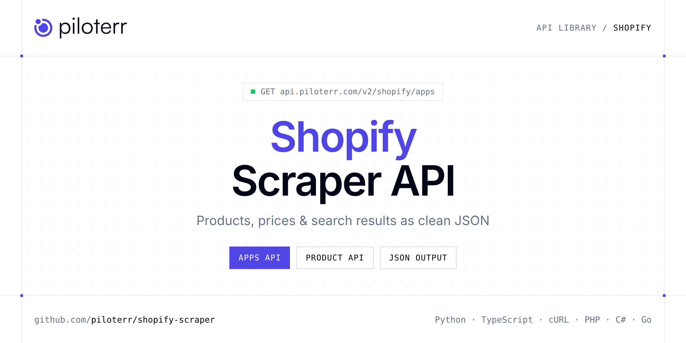

<p align="center">
  <a href="https://www.piloterr.com"></a>
</p>

# Shopify Scraper API

[](https://discord.gg/CFj3ph8aHU) [](https://app.piloterr.com) [](https://app.piloterr.com/openapi) [](LICENSE)

The **Piloterr Shopify Scraper API** lets you extract public data from Shopify as **clean, structured JSON** — no proxies, headless browsers or HTML parsing to maintain. Endpoints available in production:

- **Shopify Apps API** — Retrieve structured details about any Shopify App Store listing, including title, logo, screenshots, pricing plans, categories, and description.
- **Shopify Catalog API** — List products from a Shopify shop.
- **Shopify Collections API** — List collections from a Shopify shop.
- **Shopify Product API** — Extract full product details from any Shopify store product page, including title, variants, pricing, images, inventory, and options.

Use it for price monitoring, assortment tracking, competitor analysis, product research or catalog enrichment.

| Endpoint | Path | Credits | What you get |
|---|---|---|---|
| [Shopify Apps API](#shopify-apps-api) | `/v2/shopify/apps` | 1 | Retrieve structured details about any Shopify App Store listing, including title, logo, screenshots, pricing plans, categories, and description. |
| [Shopify Catalog API](#shopify-catalog-api) | `/v2/shopify/catalog` | 1 | List products from a Shopify shop. query is the shop domain or a URL on that shop. page and limit choose the slice. |
| [Shopify Collections API](#shopify-collections-api) | `/v2/shopify/collections` | 1 | List collections from a Shopify shop. query is the shop domain or a URL on that shop. page and limit choose the slice. |
| [Shopify Product API](#shopify-product-api) | `/v2/shopify/product` | 1 | Extract full product details from any Shopify store product page, including title, variants, pricing, images, inventory, and options. |

## Table of contents

- [How it works](#how-it-works)
- [Shopify Apps API](#shopify-apps-api)
- [Shopify Catalog API](#shopify-catalog-api)
- [Shopify Collections API](#shopify-collections-api)
- [Shopify Product API](#shopify-product-api)
- [Code examples in other languages](#code-examples-in-other-languages)
- [Practical use cases](#practical-use-cases)
- [Why Piloterr?](#why-piloterr)
- [FAQ](#faq)
- [Related scrapers](#related-scrapers)
- [Support](#support)

## How it works

1. **Create a free Piloterr account** and copy your API key from the [dashboard](https://app.piloterr.com).
2. **Send a `GET` (or `POST`) request** to `https://api.piloterr.com/v2/...` with the header `x-api-key: YOUR_API_KEY`.
3. **Receive structured JSON** — Piloterr handles rendering, proxies, retries and parsing.

```bash
export PILOTERR_API_KEY="your-api-key"
pip install requests        # Python
# TypeScript: Node.js 18+ (native fetch), run with `npx tsx file.ts`
```

> Every endpoint accepts both `GET` (query string) and `POST` (JSON body with the same fields).

## Shopify Apps API

Retrieve structured details about any Shopify App Store listing, including title, logo, screenshots, pricing plans, categories, and description.

`GET | POST https://api.piloterr.com/v2/shopify/apps` · **1 credit per request** · [Full reference](https://app.piloterr.com/openapi)

### Request parameters

| Parameter | Type | Required | Description |
|---|---|---|---|
| `query` | string | ✅ | URL of the Shopify App Store listing to scrape. |

### Python example

```python
import json
import os
import requests

response = requests.get(
    "https://api.piloterr.com/v2/shopify/apps",
    headers={"x-api-key": os.environ["PILOTERR_API_KEY"]},
    params={
        "query": "https://apps.shopify.com/judgeme",
    },
    timeout=120,
)
response.raise_for_status()
data = response.json()

print(json.dumps(data, indent=2, ensure_ascii=False)[:2000])
```

### TypeScript example

```typescript
type ShopifyApps = {
  url?: string;
  logo?: string;
  title?: string;
  handle?: string;
  images?: {
    url?: string;
    description?: string;
  }[];
  pricing?: {
    name?: string;
    price?: string;
    features?: string[];
  }[];
  categories?: unknown[];
  description?: string;
};

const params = new URLSearchParams({
  "query": "https://apps.shopify.com/judgeme",
});

const response = await fetch(`https://api.piloterr.com/v2/shopify/apps?${params}`, {
  headers: { "x-api-key": process.env.PILOTERR_API_KEY! },
});
if (!response.ok) throw new Error(`Piloterr error ${response.status}: ${await response.text()}`);

const data = (await response.json()) as ShopifyApps;

console.log(JSON.stringify(data, null, 2).slice(0, 2000));
```

<details>
<summary><b>POST variant</b></summary>

```http
POST https://api.piloterr.com/v2/shopify/apps
x-api-key: YOUR_API_KEY
Content-Type: application/json

{"query": "https://apps.shopify.com/judgeme"}
```
</details>

### Output example

Example response from the API reference, abridged — real values depend on the page you scrape.

```json
{
  "url": "https://apps.shopify.com/judgeme",
  "logo": "https://cdn.shopify.com/app-store/listing_images/8cada0f5da411a64e756606bb036f1ed/icon/CIfp9fWd34sDEAE=.png",
  "title": "Judge.me Product Reviews App",
  "handle": "judgeme",
  "images": [
    {
      "url": "https://cdn.shopify.com/app-store/listing_images/8cada0f5da411a64e756606bb036f1ed/desktop_screenshot/CJ3w-uC_140DEAE=.png?height=360&widt…",
      "description": "Collect unlimited reviews automatically from email, SMS, QR code"
    },
    {
      "url": "https://cdn.shopify.com/app-store/listing_images/8cada0f5da411a64e756606bb036f1ed/desktop_screenshot/CPWYhuG_140DEAE=.png?height=360&widt…",
      "description": "Display reviews with Star Rating, Review Widget, Carousel & more"
    }
  ],
  "pricing": [
    {
      "name": "Forever Free",
      "price": "Free",
      "features": [
        "Google rich snippets & Google MyBusiness",
        "Carousels (Video, Cards, Testimonials)"
      ]
    },
    {
      "name": "Awesome",
      "price": "$15/month",
      "features": [
        "Meta & TikTokShop sync, SocialMedia push",
        "Coupons & Referrals"
      ]
    }
  ],
  "categories": [],
  "description": "Sell more with unlimited product reviews, UGC, star ratings, and testimonials. Judge.me boosts conversion rate with unlimited product rev…"
}
```

### Response fields

| Field | Type | Description |
|---|---|---|
| `url` | string |  |
| `logo` | string |  |
| `title` | string |  |
| `handle` | string |  |
| `images[]` | object[] |  |
| `images[].url` | string |  |
| `images[].description` | string |  |
| `pricing[]` | object[] |  |
| `pricing[].name` | string |  |
| `pricing[].price` | string |  |
| `pricing[].features` | string[] |  |
| `categories` | any[] |  |
| `description` | string |  |

## Shopify Catalog API

List products from a Shopify shop. query is the shop domain or a URL on that shop. page and limit choose the slice.

`GET | POST https://api.piloterr.com/v2/shopify/catalog` · **1 credit per request** · [Full reference](https://app.piloterr.com/openapi)

### Request parameters

| Parameter | Type | Required | Description |
|---|---|---|---|
| `query` | string | ✅ | Shop domain or a URL on that shop. |
| `page` | number | — | Page number, starting at 1. |
| `limit` | number | — | How many items to return on this page. |

### Python example

```python
import json
import os
import requests

response = requests.get(
    "https://api.piloterr.com/v2/shopify/catalog",
    headers={"x-api-key": os.environ["PILOTERR_API_KEY"]},
    params={
        "query": "https://www.decathlon.com",
    },
    timeout=120,
)
response.raise_for_status()
data = response.json()

print(json.dumps(data, indent=2, ensure_ascii=False)[:2000])
```

### TypeScript example

```typescript
type ShopifyCatalog = {
  results?: {
    id?: number;
    url?: string;
    tags?: string[];
    image?: {
      alt?: unknown;
      src?: string;
      width?: number;
      height?: number;
      position?: number;
    };
    title?: string;
    handle?: string;
    images?: {
      alt?: unknown;
      src?: string;
      width?: number;
      height?: number;
      position?: number;
    }[];
    vendor?: string;
    options?: {
      name?: string;
      values?: string[];
      position?: number;
    }[];
    variants?: {
      id?: number;
      sku?: string;
      grams?: number;
      price?: number;
      title?: string;
      option1?: string;
      option2?: unknown;
      option3?: unknown;
      available?: boolean;
      price_display?: string;
      compare_at_price?: unknown;
      compare_at_price_display?: unknown;
    }[];
    created_at?: string;
    updated_at?: string;
    description?: string;
    product_type?: string;
    published_at?: string;
  }[];
  pagination?: {
    next?: string;
    page?: number;
    per_page?: number;
    total_pages?: unknown;
    total_results?: unknown;
  };
};

const params = new URLSearchParams({
  "query": "https://www.decathlon.com",
});

const response = await fetch(`https://api.piloterr.com/v2/shopify/catalog?${params}`, {
  headers: { "x-api-key": process.env.PILOTERR_API_KEY! },
});
if (!response.ok) throw new Error(`Piloterr error ${response.status}: ${await response.text()}`);

const data = (await response.json()) as ShopifyCatalog;

console.log(JSON.stringify(data, null, 2).slice(0, 2000));
```

<details>
<summary><b>POST variant</b></summary>

```http
POST https://api.piloterr.com/v2/shopify/catalog
x-api-key: YOUR_API_KEY
Content-Type: application/json

{"query": "https://www.decathlon.com"}
```
</details>

### Output example

Example response from the API reference, abridged — real values depend on the page you scrape.

```json
{
  "results": [
    {
      "id": 8209730371646,
      "url": "https://www.decathlon.com/products/men-s-hiking-jacket-mh500-brown",
      "tags": [
        "Down Jackets",
        "FAMILY: 11413"
      ],
      "image": {
        "alt": null,
        "src": "https://cdn.shopify.com/s/files/1/1330/6287/files/default_61e4eded-7b52-4c7e-b922-fdfec444efd1.jpg?v=1793283479",
        "width": 969,
        "height": 969,
        "position": 1
      },
      "title": "Quechua Men’s MH500 Synthetic Puffer Jacket",
      "handle": "men-s-hiking-jacket-mh500-brown",
      "images": [
        {},
        {}
      ],
      "vendor": "Quechua",
      "options": [
        {}
      ],
      "variants": [
        {},
        {}
      ],
      "created_at": "2026-08-10T07:57:16-07:00",
      "updated_at": "2026-10-30T10:41:35-07:00",
      "description": "When the temperature drops, this down jacket is your perfect companion, offering warmth, slim fit, a hood and ideal comfort for your excu…",
      "product_type": "Padded Jacket",
      "published_at": "2026-10-29T06:59:49-07:00"
    }
  ],
  "pagination": {
    "next": "https://www.decathlon.com/products.json?limit=1&page=2",
    "page": 1,
    "per_page": 1,
    "total_pages": null,
    "total_results": null
  }
}
```

### Response fields

| Field | Type | Description |
|---|---|---|
| `results[]` | object[] |  |
| `results[].id` | integer |  |
| `results[].url` | string |  |
| `results[].tags` | string[] |  |
| `results[].image` | object |  |
| `results[].title` | string |  |
| `results[].handle` | string |  |
| `results[].images[]` | object[] |  |
| `results[].vendor` | string |  |
| `results[].options[]` | object[] |  |
| `results[].variants[]` | object[] |  |
| `results[].created_at` | string |  |
| `results[].updated_at` | string |  |
| `results[].description` | string |  |
| `results[].product_type` | string |  |
| `results[].published_at` | string |  |
| `pagination` | object |  |
| `pagination.next` | string |  |
| `pagination.page` | integer |  |
| `pagination.per_page` | integer |  |
| `pagination.total_pages` | object |  |
| `pagination.total_results` | object |  |

## Shopify Collections API

List collections from a Shopify shop. query is the shop domain or a URL on that shop. page and limit choose the slice.

`GET | POST https://api.piloterr.com/v2/shopify/collections` · **1 credit per request** · [Full reference](https://app.piloterr.com/openapi)

### Request parameters

| Parameter | Type | Required | Description |
|---|---|---|---|
| `query` | string | ✅ | Shop domain or a URL on that shop. |
| `page` | number | — | Page number, starting at 1. |
| `limit` | number | — | How many items to return on this page. |

### Python example

```python
import json
import os
import requests

response = requests.get(
    "https://api.piloterr.com/v2/shopify/collections",
    headers={"x-api-key": os.environ["PILOTERR_API_KEY"]},
    params={
        "query": "https://www.decathlon.com",
    },
    timeout=120,
)
response.raise_for_status()
data = response.json()

print(json.dumps(data, indent=2, ensure_ascii=False)[:2000])
```

### TypeScript example

```typescript
type ShopifyCollections = {
  results?: {
    id?: number;
    url?: string;
    image?: unknown;
    title?: string;
    handle?: string;
    updated_at?: string;
    description?: string;
    published_at?: string;
    products_count?: number;
  }[];
  pagination?: {
    next?: string;
    page?: number;
    per_page?: number;
    total_pages?: unknown;
    total_results?: unknown;
  };
};

const params = new URLSearchParams({
  "query": "https://www.decathlon.com",
});

const response = await fetch(`https://api.piloterr.com/v2/shopify/collections?${params}`, {
  headers: { "x-api-key": process.env.PILOTERR_API_KEY! },
});
if (!response.ok) throw new Error(`Piloterr error ${response.status}: ${await response.text()}`);

const data = (await response.json()) as ShopifyCollections;

console.log(JSON.stringify(data, null, 2).slice(0, 2000));
```

<details>
<summary><b>POST variant</b></summary>

```http
POST https://api.piloterr.com/v2/shopify/collections
x-api-key: YOUR_API_KEY
Content-Type: application/json

{"query": "https://www.decathlon.com"}
```
</details>

### Output example

Example response from the API reference, abridged — real values depend on the page you scrape.

```json
{
  "results": [
    {
      "id": 261040504894,
      "url": "https://www.decathlon.com/collections/camping-tents-2-3-person",
      "image": null,
      "title": "2-Person Tents",
      "handle": "camping-tents-2-3-person",
      "updated_at": "2026-10-29T04:06:55-07:00",
      "description": "<h2><span>The perfect 2-person tent for camping</span></h2>\n<p dir=\"ltr\"><span>Embark on your next outdoor adventure with a Decathlon 2-p…",
      "published_at": "2021-04-15T12:37:52-07:00",
      "products_count": 2
    }
  ],
  "pagination": {
    "next": "https://www.decathlon.com/collections.json?limit=1&page=2",
    "page": 1,
    "per_page": 1,
    "total_pages": null,
    "total_results": null
  }
}
```

### Response fields

| Field | Type | Description |
|---|---|---|
| `results[]` | object[] |  |
| `results[].id` | integer |  |
| `results[].url` | string |  |
| `results[].image` | object |  |
| `results[].title` | string |  |
| `results[].handle` | string |  |
| `results[].updated_at` | string |  |
| `results[].description` | string |  |
| `results[].published_at` | string |  |
| `results[].products_count` | integer |  |
| `pagination` | object |  |
| `pagination.next` | string |  |
| `pagination.page` | integer |  |
| `pagination.per_page` | integer |  |
| `pagination.total_pages` | object |  |
| `pagination.total_results` | object |  |

## Shopify Product API

Extract full product details from any Shopify store product page, including title, variants, pricing, images, inventory, and options.

`GET | POST https://api.piloterr.com/v2/shopify/product` · **1 credit per request** · [Full reference](https://app.piloterr.com/openapi)

### Request parameters

| Parameter | Type | Required | Description |
|---|---|---|---|
| `query` | string | ✅ | URL of a Shopify product page to scrape. |

### Python example

```python
import json
import os
import requests

response = requests.get(
    "https://api.piloterr.com/v2/shopify/product",
    headers={"x-api-key": os.environ["PILOTERR_API_KEY"]},
    params={
        "query": "https://www.decathlon.com/products/simond-backpacking-sleeping-bag-mt500-41-f-synthetic-346446",
    },
    timeout=120,
)
response.raise_for_status()
data = response.json()

print(json.dumps(data, indent=2, ensure_ascii=False)[:2000])
```

### TypeScript example

```typescript
type ShopifyProduct = {
  id?: number;
  tags?: string;
  image?: {
    id?: number;
    alt?: string;
    src?: string;
    width?: number;
    height?: number;
    position?: number;
    created_at?: string;
    product_id?: number;
    updated_at?: string;
  };
  title?: string;
  handle?: string;
  vendor?: string;
  options?: {
    id?: number;
    name?: string;
    values?: string[];
    position?: number;
    product_id?: number;
  }[];
  variants?: {
    id?: number;
    sku?: string;
    grams?: number;
    price?: string;
    title?: string;
    weight?: number;
    barcode?: string;
    option1?: string;
    option2?: string;
    taxable?: boolean;
    position?: number;
    created_at?: string;
    product_id?: number;
    updated_at?: string;
    weight_unit?: string;
    compare_at_price?: string;
    inventory_policy?: string;
    requires_shipping?: boolean;
    inventory_quantity?: number;
    fulfillment_service?: string;
    inventory_management?: string;
  }[];
  body_html?: string;
  created_at?: string;
  updated_at?: string;
  product_type?: string;
  published_at?: string;
  published_scope?: string;
  template_suffix?: string;
};

const params = new URLSearchParams({
  "query": "https://www.decathlon.com/products/simond-backpacking-sleeping-bag-mt500-41-f-synthetic-346446",
});

const response = await fetch(`https://api.piloterr.com/v2/shopify/product?${params}`, {
  headers: { "x-api-key": process.env.PILOTERR_API_KEY! },
});
if (!response.ok) throw new Error(`Piloterr error ${response.status}: ${await response.text()}`);

const data = (await response.json()) as ShopifyProduct;

console.log(JSON.stringify(data, null, 2).slice(0, 2000));
```

<details>
<summary><b>POST variant</b></summary>

```http
POST https://api.piloterr.com/v2/shopify/product
x-api-key: YOUR_API_KEY
Content-Type: application/json

{"query": "https://www.decathlon.com/products/simond-backpacking-sleeping-bag-mt500-41-f-synthetic-346446"}
```
</details>

### Output example

Example response from the API reference, abridged — real values depend on the page you scrape.

```json
{
  "id": 7017883533374,
  "tags": "Adult, Boy's, DEAL, FAMILY: 10645, Gift_Ideas, Holiday Product List, Kids, mask-snorkel-fins-set, Men's, WATER_SPORTS, Women's",
  "image": {
    "id": 30763514069054,
    "alt": "{*blue-8732687*}",
    "src": "https://cdn.shopify.com/s/files/1/1330/6287/files/8732687-product_image-p2143297.jpg?v=1700515471",
    "width": 2000,
    "height": 2000,
    "position": 1,
    "created_at": "2023-11-15T10:22:37-08:00",
    "product_id": 7017883533374,
    "updated_at": "2023-11-20T13:24:31-08:00"
  },
  "title": "Adult's Easybreath Surface Mask Acoustic Valve - 540 Freetalk Jungle",
  "handle": "adults-easybreath-surface-mask-acoustic-valve-540-freetalk-blue-330093",
  "vendor": "Subea",
  "options": [
    {
      "id": 9022772510782,
      "name": "Color",
      "values": [
        "Royal Blue",
        "Blue"
      ],
      "position": 1,
      "product_id": 7017883533374
    },
    {
      "id": 9022772543550,
      "name": "Size",
      "values": [
        "S/M",
        "ML"
      ],
      "position": 2,
      "product_id": 7017883533374
    }
  ],
  "variants": [
    {
      "id": 40088252186686,
      "sku": "4200766",
      "grams": 639,
      "price": "30.00",
      "title": "Royal Blue / S/M / 8613126",
      "weight": 0.639,
      "barcode": "3608390035854",
      "option1": "Royal Blue",
      "option2": "S/M",
      "taxable": true,
      "position": 1,
      "created_at": "2023-06-05T04:22:25-07:00",
      "product_id": 7017883533374,
      "updated_at": "2024-01-07T11:17:33-08:00",
      "weight_unit": "kg",
      "compare_at_price": "49.99",
      "inventory_policy": "deny",
      "requires_shipping": true,
      "inventory_quantity": 0,
      "fulfillment_service": "manual",
      "inventory_management": "shopify"
    }
  ],
  "body_html": "<h4>Description</h4><p>The Easybreath 540 full-face snorkel mask is designed for use by adults and teens. The mask comes in two different…",
  "created_at": "2022-07-11T23:04:31-07:00",
  "updated_at": "2024-01-07T11:17:33-08:00",
  "product_type": "Diving mask",
  "published_at": "2022-07-12T10:15:36-07:00",
  "published_scope": "web",
  "template_suffix": ""
}
```

### Response fields

| Field | Type | Description |
|---|---|---|
| `id` | integer |  |
| `tags` | string |  |
| `image` | object |  |
| `image.id` | integer |  |
| `image.alt` | string |  |
| `image.src` | string |  |
| `image.width` | integer |  |
| `image.height` | integer |  |
| `image.position` | integer |  |
| `image.created_at` | string |  |
| `image.product_id` | integer |  |
| `image.updated_at` | string |  |
| `title` | string |  |
| `handle` | string |  |
| `vendor` | string |  |
| `options[]` | object[] |  |
| `options[].id` | integer |  |
| `options[].name` | string |  |
| `options[].values` | string[] |  |
| `options[].position` | integer |  |
| `options[].product_id` | integer |  |
| `variants[]` | object[] |  |
| `variants[].id` | integer |  |
| `variants[].sku` | string |  |
| `variants[].grams` | integer |  |

## Code examples in other languages

Ready-to-run examples live in the [`examples/`](examples) folder. Each one reads your key from the `PILOTERR_API_KEY` environment variable.

| Language | Apps | Catalog | Collections | Product |
|---|---|---|---|---|
| cURL (Bash) | [`apps`](examples/curl/apps.sh) | [`catalog`](examples/curl/catalog.sh) | [`collections`](examples/curl/collections.sh) | [`product`](examples/curl/product.sh) |
| PHP | [`apps`](examples/php/apps.php) | [`catalog`](examples/php/catalog.php) | [`collections`](examples/php/collections.php) | [`product`](examples/php/product.php) |
| C# | [`apps`](examples/csharp/Apps.cs) | [`catalog`](examples/csharp/Catalog.cs) | [`collections`](examples/csharp/Collections.cs) | [`product`](examples/csharp/Product.cs) |
| Go | [`apps`](examples/go/apps.go) | [`catalog`](examples/go/catalog.go) | [`collections`](examples/go/collections.go) | [`product`](examples/go/product.go) |
| Java | [`apps`](examples/java/AppsExample.java) | [`catalog`](examples/java/CatalogExample.java) | [`collections`](examples/java/CollectionsExample.java) | [`product`](examples/java/ProductExample.java) |
| Ruby | [`apps`](examples/ruby/apps.rb) | [`catalog`](examples/ruby/catalog.rb) | [`collections`](examples/ruby/collections.rb) | [`product`](examples/ruby/product.rb) |
| Node.js | [`apps`](examples/nodejs/apps.mjs) | [`catalog`](examples/nodejs/catalog.mjs) | [`collections`](examples/nodejs/collections.mjs) | [`product`](examples/nodejs/product.mjs) |

## Practical use cases

- **Price monitoring** — Track prices, promotions and availability over time to react to competitors.
- **Assortment & catalog tracking** — Follow new products, delisted items and category changes.
- **Competitor analysis** — Benchmark ranges, brands and positioning across retailers.
- **Product research** — Spot best-sellers and trends from search results.
- **Catalog enrichment** — Pull titles, images and attributes into your PIM or marketplace listings.

## Why Piloterr?

- **No infrastructure** — no proxies, headless browsers or CAPTCHA solving to run yourself.
- **Structured JSON** — stable, documented fields instead of brittle HTML selectors.
- **Pay per request** — transparent credit cost per endpoint, failed requests are retried for you.
- **One API key, hundreds of sources** — Shopify plus many other e-commerce, search and company data endpoints in the [Piloterr library](https://www.piloterr.com/library).
- **Any language** — plain HTTPS + JSON, with examples for Python, TypeScript, cURL, PHP, C#, Go, Java, Ruby and Node.js.

## FAQ

### Is it legal to scrape Shopify?

Collecting publicly available data is generally allowed in many jurisdictions, but rules depend on your country, the data you collect and how you use it. Avoid personal data unless you have a lawful basis, respect the website's terms where they apply, and get legal advice for your specific use case. This is not legal advice.

### Do I need proxies or a headless browser?

No. Piloterr handles rendering, proxy rotation and retries on its side. You only send an HTTPS request with your `x-api-key` header and receive JSON.

### How much does a request cost?

Credits per call: `/v2/shopify/apps` **1**, `/v2/shopify/catalog` **1**, `/v2/shopify/collections` **1**, `/v2/shopify/product` **1**. See the [Piloterr website](https://www.piloterr.com) for plans.

### What data does the Shopify API return?

Each endpoint returns structured JSON: **Shopify Apps** — `url`, `logo`, `title`, `handle`, `images[]`, `images[].url`; **Shopify Catalog** — `results[]`, `results[].id`, `results[].url`, `results[].tags`, `results[].image`, `results[].title`; **Shopify Collections** — `results[]`, `results[].id`, `results[].url`, `results[].image`, `results[].title`, `results[].handle`; **Shopify Product** — `id`, `tags`, `image`, `image.id`, `image.alt`, `image.src`.

### How do I paginate Shopify results?

Use the `page` parameter and keep requesting while the response indicates more results.

### Which languages are supported?

Any language that can make an HTTP request. This README shows Python and TypeScript; the [`examples/`](examples) folder contains cURL, PHP, C#, Go, Java, Ruby and Node.js.

## Related scrapers

- [About You Scraper API](https://github.com/piloterr/aboutyou-scraper)
- [Action Scraper API](https://github.com/piloterr/action-scraper)
- [Aldi Scraper API](https://github.com/piloterr/aldi-scraper)
- [Alibaba Scraper API](https://github.com/piloterr/alibaba-scraper)
- [AliExpress Scraper API](https://github.com/piloterr/aliexpress-scraper)
- [Allegro Scraper API](https://github.com/piloterr/allegro-scraper)
- [All Piloterr scrapers on GitHub](https://github.com/piloterr)

## Support

- 💬 Join the [Piloterr Discord](https://discord.gg/CFj3ph8aHU) to ask questions and share what you build.
- 📚 Browse the [API reference (OpenAPI)](https://app.piloterr.com/openapi) and the [Piloterr library](https://www.piloterr.com/library).
- 🔑 [Get your API key](https://app.piloterr.com).

---

<p align="center">
  <a href="https://www.piloterr.com">
    <picture>
      <source media="(prefers-color-scheme: dark)" srcset="images/logo-dark.svg">
      
    </picture>
  </a>
  <br>
  <sub>Built by <a href="https://www.piloterr.com">Piloterr</a> — web scraping APIs for e-commerce, search, real estate and more, one API key.</sub>
</p>

<sub>Shopify is a trademark of its respective owner. This repository is not affiliated with or endorsed by Shopify. Examples are released under the MIT license.</sub>
